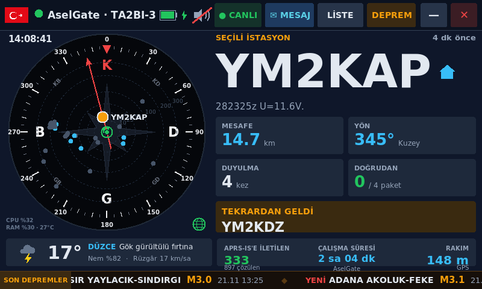
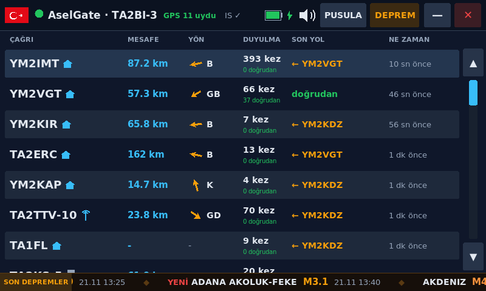
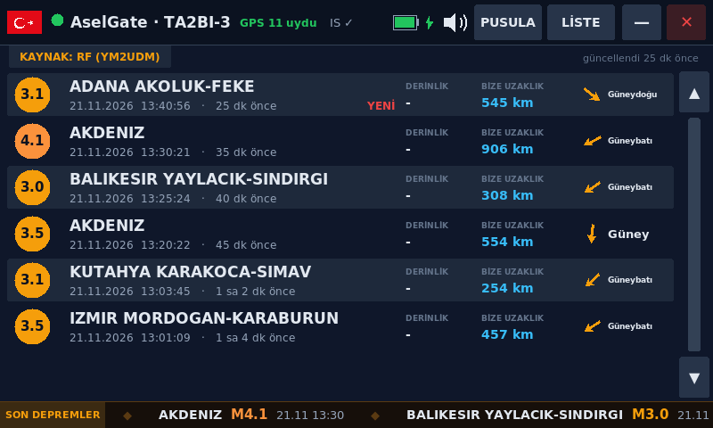
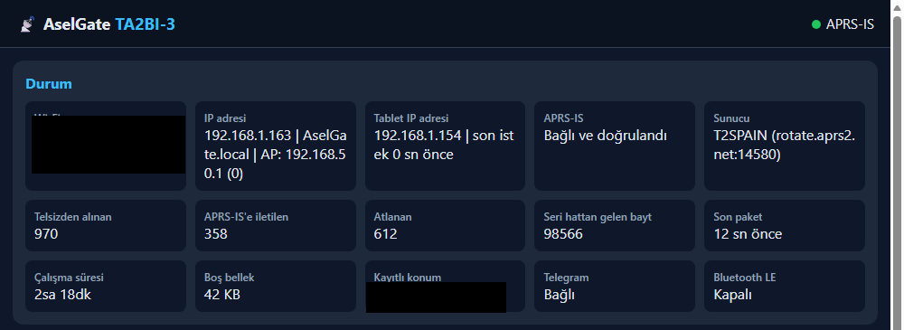
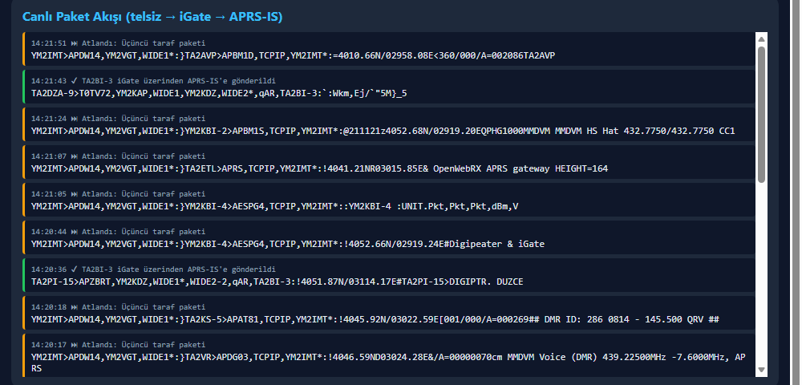
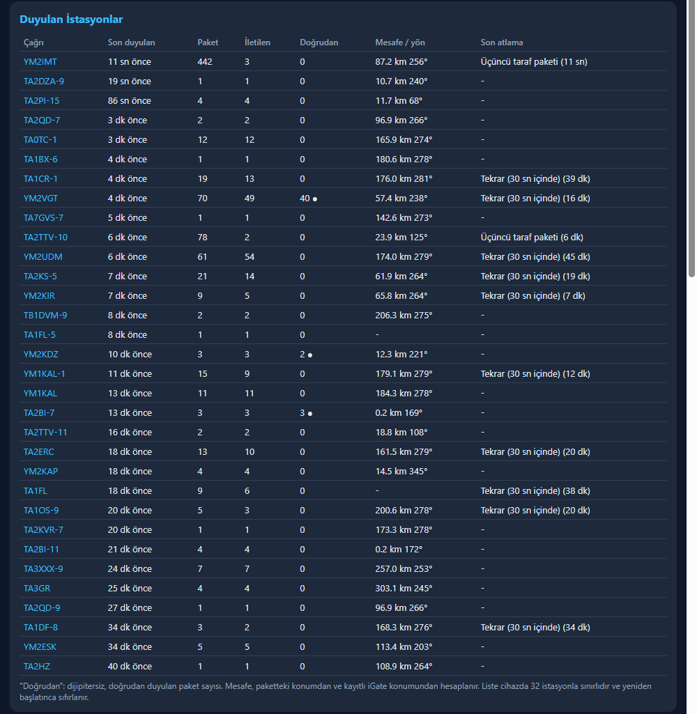
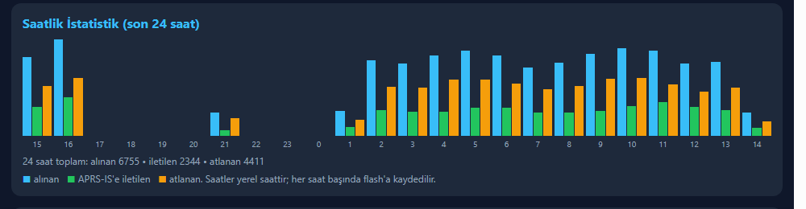

# AselGate Ekran

AselGate iGate cihazının (ESP32, APRS iGate) verilerini bir tablette ya da bilgisayarda gösteren
Türkçe dokunmatik/masaüstü uygulaması. Telsizden duyulan APRS istasyonlarını, pusulayı, gelen
APRS mesajlarını, depremleri ve hava durumunu tek ekranda sunar.

> Bu proje amatör telsiz (APRS) kullanıcıları içindir. APRS-IS'e yayın yapmak için geçerli bir
> amatör telsiz lisansı ve çağrı işareti gerekir.

## Özellikler

- **Pusula ekranı:** Duyulan istasyonları yön ve mesafeye göre gösterir. Mesafe halkaları, derece
  cetveli, seçili istasyona ibre. Kadran 15 dakikada bir kendi etrafında döner (açılışta bir kez).
- **İstasyonlar:** Duyulan çağrı işaretleri, son duyulma zamanı, kaç kez duyulduğu, doğrudan mı
  yoksa hangi digipeater ile geldiği.
- **MESAJLAR:** Size gelen APRS mesajlarını saklar ve yanıtlanabilir. Mesaj gönderme (67 karakter).
  Mesajlar bir kez alınır, tekrar eden kopyalar ekrana düşmez.
- **MIC-E durum seçici:** Kapalı (normal konum) ve Mic-E'nin 8 durumundan birini AselGate üzerinden
  APRS-IS'e gönderir. **ACİL DURUM** seçilirse önce onay sorulur.
- **BEACON TX:** Konum işaretçisini hemen gönderir.
- **DEPREM:** Deprem paketlerini YM2UDM relay istasyonundan (RF) ya da Kandilli'nin resmi
  sitesinden (internet) okur. Yeni deprem için tam ekran uyarı verir; aynı deprem bir daha uyarmaz.
- **Hava durumu, GPS, pil ve sistem sağlığı** göstergeleri.
- **AselGate bağlantısı:** AselGate'in IP adresini girme, otomatik bulma ve AselGate'in kendi
  Wi-Fi ağına doğrudan bağlanma. Tablet IP'si de burada gösterilir.

## Ekran görüntüleri

**Pusula:** Duyulan istasyonlar yön ve mesafeye göre gösterilir. Üstteki çubukta AselGate
durumu, uydu sayısı, pil ve ses düğmeleri, ortada son duyulan istasyon ve hava durumu yer alır.

**İstasyon listesi:** Duyulan çağrı işaretleri, mesafe, yön, kaç kez duyulduğu ve hangi digipeater
üzerinden geldiği (son yol sütunu). Örneğin YM2KDZ bu ekranda digipeater olarak görünür.

**Depremler:** Kandilli ve YM2UDM RF relay'inden gelen son depremler, büyüklük, derinlik ve uzaklık.
Yeni deprem geldiğinde "YENİ" etiketi çıkar.

> Ekran görüntüleri 800x480 dokunmatik tabletten alınmıştır. Mesaj ekranı, içinde başkalarının
> özel mesajları olduğu için buraya eklenmemiştir.

### iGate web arayüzü

ESP32 iGate'in kendi web arayüzü (`http://AselGate.local` ya da cihazın IP adresi). Durum, canlı
paket akışı, duyulan istasyonlar ve 24 saatlik istatistik burada görünür.

**Durum:** APRS-IS bağlantısı, sunucu, telsizden alınan ve APRS-IS'e iletilen paket sayıları.

**Canlı paket akışı:** Telsizden gelen paketler, iGate'in APRS-IS'e gönderdikleri ve atladıkları.

**Duyulan istasyonlar:** Çağrı işareti, son duyulma, paket sayısı, mesafe ve yön.

**Saatlik istatistik:** Son 24 saatte alınan, iletilen ve atlanan paketler.

> Ayarlar ve Wi-Fi bölümleri, şifre ve konum bilgisi içerdiği için buraya eklenmemiştir. Durum
> ekranındaki Wi-Fi adı ve kayıtlı konum karartılmıştır.

## ESP32 iGate yazılımı (AselGate firmware)

TA7W öncülüğünden Aselsan 4000 serisi telsizlere yapılan yeni yazılım güncellemesinin ardından
gelen APRS IGATE özelliğini kullanabilmek için hazırladığım devre şeması ve yazılımı sizlerle
paylaşıyorum.

Yazılım **ESP32-C3** için derlenmiştir. Kaynak kodu bu depoda yer almaz; hazır derlenmiş dosyalar
[v1.11.2 sürümünde](https://github.com/mozbey/AselGateEkran/releases) bulunur.

### Donanım

- **Kart:** ESP32-C3 (ESP32-C3 Super Mini).
- **Telsiz bağlantısı:** ASELSAN 4021 E telsizin Pin 7 (Tx veri) çıkışı, MAX3232 üzerinden ESP32
  GPIO5 (RX) girişine bağlanır. ESP32 yalnızca dinler, TX kullanılmaz.
- **GPS:** NEO-6M verisi MAX3232 üzerinden telsiz hattına gider. ESP32 bu veriyi yalnızca okur.
- **Devre şeması:** [`devre-semasi/AselGate-v4.pdf`](devre-semasi/AselGate-v4.pdf)

### Kurulum (ilk kez)

1. Release sayfasından `AselGate-v1.11.2-ESP32C3-tam.bin` dosyasını indirin.
2. Kartı USB ile bağlayın. Tarayıcıdan https://espressif.github.io/esptool-js/ adresine girin,
   "Connect" ile kartı seçin, dosyayı **0x0** adresine yükleyip "Program" deyin.
   Bu işlem kartta kayıtlı ayarları siler.
3. Alternatif (komut satırı): `pip install esptool`, ardından
   `esptool --chip esp32c3 --port COMx write-flash 0x0 AselGate-v1.11.2-ESP32C3-tam.bin`
   (Linux'ta port `/dev/ttyACM0` gibi olur.)

### İlk kullanım

1. Telefon ya da bilgisayarla **AselGate** adlı Wi-Fi ağına bağlanın. Şifre: `12345678`.
2. Tarayıcıdan http://192.168.50.1 adresini açın.
3. "Wi-Fi" bölümünden kendi ağınızı ekleyin.
4. "Ayarlar" bölümünden çağrı işaretinizi, passcode'unuzu ve konumunuzu girin, kaydedin.
5. Cihaz ağa bağlanınca http://AselGate.local adresinden de erişebilirsiniz.

### Dikkat edilecekler

- **Varsayılan Wi-Fi şifresi (12345678) herkeste aynıdır.** Bu şifre arayüzden değiştirilemez,
  değiştirmek için yazılımın yeniden derlenmesi gerekir. Cihazı yalnızca kendi ağınızda ya da
  güvenilir bir yerde çalıştırın.
- **Yazılım kendi durum metnini ve telemetri başlığını taşır** ("ASELSAN iGate - yAtolye /TA2BI").
  Kendi istasyonunuzu kullanacaksanız bunu kendi çağrı işaretinizle yeniden derlemeniz gerekir.
- Passcode yanlışsa cihaz yalnızca alır, APRS-IS'e yayın yapamaz.
- APRS-IS'e yayın için geçerli bir amatör telsiz lisansı ve çağrı işareti gerekir.

## Gereksinimler

- **AselGate donanımı:** ESP32-C3 tabanlı AselGate iGate ve firmware (sürüm 1.11.2,
  ayrıntılar için [Firmware bölümü](#esp32-igate-yazılımı-aselgate-firmware)).
- **Uygulama:** Hazır program, Python gerekmez. Windows ve Linux için ayrı paketler (aşağıya bakın).

## Kurulum

### Windows
1. `AselGateEkran-windows.zip` dosyasını açın.
2. `AselGateEkran.exe` dosyasına çift tıklayın.
3. Program tam ekran açılır. Ayarlardan "tam ekran" kapatılabilir.

Windows'ta Linux'a özgü özellikler (xrandr, dokunmatik kalibrasyon, `/dev` altındaki GPS) çalışmaz,
bu özellikler devre dışı kalır. Diğer özellikler çalışır.

### Linux (antiX, Debian, Ubuntu vb.)
1. `aselgate-ekran-linux.zip` dosyasını açın ve klasöre girin.
3. Kurun: `sh install.sh` (oturum açılışında otomatik başlatmak için `sh install.sh --autostart`)
4. Başlatın: `aselgate-ekran` ya da uygulama menüsünde "AselGate Ekran".
5. Kaldırmak için: `sh uninstall.sh`

## İlk ayar

Uygulama ilk açılışta AselGate'in adresini ister. Varsayılan `192.168.1.163`, sizin ağınızda farklı
olabilir. **AselGate bağlantısı** ekranından adresi değiştirin ya da **OTOMATİK BUL** ile arayın.
Ayarlar `~/.config/aselgate-ekran.json` dosyasında tutulur (Windows'ta `C:\Users\<kullanıcı>\.config\`).

## Dikkat edilecekler

- **Acil durum ve Mic-E yayını:** MIC-E ACİL DURUM, AselGate üzerinden APRS-IS'e (internet) gider ve
  kaldırılana kadar 2 dakikada bir yinelenir. Yanlışlıkla açmamak için onay ekranı vardır. Kapatmak
  için MIC-E seçicisinde "Kapalı" seçilmelidir.
- **Telsiz ve yayın:** AselGate'te telsiz vericisi yoktur. Konum ve mesajlar telsizden değil
  APRS-IS (internet) üzerinden gider. Yayın yapmadan önce kendi çağrı işaretinizi ve lisans
  kurallarınızı kontrol edin.
- **Parolalar:** APRS-IS passcode'u, AselGate web arayüz şifresi ve Telegram token'ı gizli tutulmalıdır.
  Bu depoda gerçek şifre ya da token bulunmaz. Ayar dosyasını (`aselgate-ekran.json`) ya da
  AselGate ayarlarını paylaşırken bu bilgileri çıkarın.
- **Ağ adresi değişebilir:** Tablet ve AselGate DHCP ile IP değiştirebilir. Modemde sabit IP
  (DHCP rezervasyonu) tanımlamanız önerilir.
- **OTA güncelleme:** AselGate firmware'i ağ üzerinden (OTA) güncellenebilir. Web arayüz şifresi
  tanımlıysa OTA da aynı şifreyi ister. Şifre tanımlamadan OTA açık bir ağda risklidir.
- **Kişisel metinler:** Açılış ekranında bir çağrı işareti ve web adresi yazar.
- **Donanım:** Uygulama dokunmatik ekran için tasarlandı, fare ile de kullanılabilir.

## Dosyalar

| Dosya | Açıklama |
|---|---|
| `aselgate-ekran` | Uygulama (derlenmiş Linux programı, 32 bit) |
| `aselgate-ekran.svg` | Uygulama simgesi |
| `install.sh` / `uninstall.sh` | Linux kurulum ve kaldırma |
| `AselGateEkran-windows.zip` | Windows için hazır program |
| `aselgate-ekran-linux.zip` | Linux kurulum paketi |

ESP32 firmware'in kaynak kodu bu depoda yer almaz; derlenmiş dosyalar sürüm sayfasında verilir.

## Sorun giderme

- **Uygulama açılmıyor (Linux):** Program 32 bit derlendiği için 64 bit sistemde
  `sudo apt install libc6-i386` çalıştırın.
- **"Yanıt yok" görünüyor:** AselGate adresinin doğru olduğunu ve AselGate'in açık olduğunu kontrol edin
  (tarayıcıdan `http://<adres>/` açılmalı).
- **Pencere kapanmıyor (Linux):** Uygulama pencere yöneticisi dışı bir pencere kullanır. Klavyede
  **Esc** tuşu uygulamayı kapatır.

## Lisans

Lisans henüz belirlenmedi.
